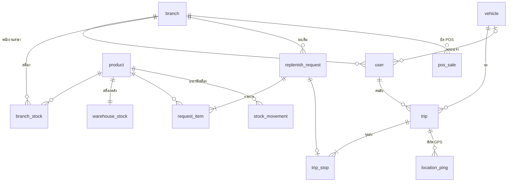

# BranchFlow

ระบบเติมสินค้าและจัดส่งระหว่างสาขา: สาขาขายของ → สต็อกลด → ระบบร่างคำขอเติมให้อัตโนมัติ → คลังกลางอนุมัติและจัดรถ → คนขับส่งพร้อมแชร์ตำแหน่ง real-time → สาขานับและยืนยันรับของ

มีผู้ใช้ 4 บทบาท

| บทบาท | ทำอะไรได้ |
|---|---|
| พนักงานสาขา | Dashboard สาขา (สต็อก, ของกำลังมา, ยอดขายรายวัน, สินค้าขายดี), ยืนยัน/แก้ร่างคำขอจากระบบ, สั่งของเอง, ติดตามรถบนแผนที่, นับและรับของ (แจ้งของขาด/เสียหาย), นับสต็อก |
| คลังกลาง (Admin) | อนุมัติ/ปฏิเสธ/ยกเลิกคำขอ (จองสต็อกคลังทันที), ดูข้อเสนอการจัดสรรเมื่อของไม่พอ, จัดเที่ยวส่งหลายสาขา (ตรวจน้ำหนักเทียบความจุรถ, เลือกรถประจำของคนขับให้อัตโนมัติ), ยกเลิกเที่ยวที่ยังไม่ออก, ดูรถทุกคันบนแผนที่, เพิ่มสินค้า, จัดการรถและคนขับ, จัดการสาขา (เพิ่มสาขาโดยปักหมุดบนแผนที่, ปิด/เปิดสาขา, บัญชีพนักงานสาขา) |
| คนขับ (มือถือ) | รับงาน, ออกเดินทาง (ตัดสต็อกคลัง + คำนวณ ETA), ส่งพิกัด GPS, นำทางด้วย Google Maps, กดถึงสาขา |
| ผู้บริหาร | KPI: จำนวนเที่ยว, % ส่งตรงเวลา, เวลาส่งเฉลี่ย, สาขาที่ของหมด, แยกตามภูมิภาค, เมนูสาขา: ดู Dashboard ของแต่ละสาขา (ดูอย่างเดียว) |

## Tech stack

- **Frontend:** React 19 + Vite, Tailwind CSS v4, React Router 7, Zustand, Axios, Socket.io client, Leaflet + OpenStreetMap (เส้นทางถนนจาก OSRM)
- **Backend:** Node.js + Express 5, Socket.io, JWT ใน httpOnly cookie, bcryptjs
- **Database:** MySQL 8 (หรือ MariaDB 10.6+)

## โครงสร้าง

```
branch-logistics/
├── client/                 React (Vite)
│   └── src/
│       ├── api/            axios instance
│       ├── components/     Layout, TripMap, NotificationBell, ui, accounts (ฟอร์มบัญชีที่ใช้ร่วมกัน)
│       ├── lib/            socket, useApi, format
│       ├── store/          auth (Zustand)
│       └── pages/          branch / admin / driver / exec
└── server/                 Express API
    ├── config/             db pool, error helpers, validate (ตรวจข้อมูลฟอร์ม)
    ├── middlewares/        auth (JWT cookie, role, branch scope)
    ├── routes/             auth, branches, branchAdmin, requests, trips, warehouse, dashboard, fleet
    ├── services/           replenish (ร่างคำขออัตโนมัติ), geo (ETA), notify, realtime, migrate, loginLimit
    ├── jobs/               งานตั้งเวลา (ส่งร่างอัตโนมัติ, สแกนสต็อก)
    └── db/                 schema.sql (โครงสร้าง ดูหัวข้อ "ฐานข้อมูล"), reset.js (seed), flow-test.js, pos-sim.js
```

## ติดตั้งและรัน

ต้องมี **Node.js 20.12+** และ **MySQL 8** (หรือ MariaDB)

### 1. Server

```bash
cd server
npm install
cp .env.example .env        # ใส่ user/รหัส MySQL ใน DATABASE_URL และตั้ง SECRET
npm run db:reset            # สร้างฐานข้อมูล ตาราง และข้อมูลตัวอย่างให้เอง
npm run dev                 # http://localhost:8000
```

ชุดข้อมูล (ทุกคำสั่ง **ลบข้อมูลเดิมทั้งหมด**)

| คำสั่ง | ได้อะไร |
|---|---|
| `npm run db:reset` | ข้อมูลตัวอย่างเต็ม: 14 สาขา, 10 สินค้า, คนขับ 3 คน, รถ 4 คัน, ยอดขายย้อนหลัง 30 วัน (แนะนำสำหรับลองระบบ) |
| `npm run db:empty` | เริ่มใหม่: 2 สาขา + บัญชีครบทุกบทบาท ยังไม่มีสินค้าและรถ ให้ Admin เพิ่มเองจากหน้าเว็บ |

(มี `npm run db:small` ชุดเล็ก 2 สาขา 3 สินค้า ไว้ทำความเข้าใจ flow ด้วย) อัปเดตโค้ดแล้วไม่ต้อง reset ตอนเปิด server ระบบปรับโครงสร้างฐานข้อมูลให้เอง

### 2. Client

```bash
cd client
npm install
npm run dev                 # http://localhost:5173
```

ถ้า API ไม่ได้อยู่ที่ `http://localhost:8000` ให้สร้าง `client/.env` แล้วตั้ง `VITE_API_URL`

## บัญชีทดลอง

บัญชีจาก `npm run db:empty` รหัสผ่าน `Demo@1234` ทุกบัญชี

| บทบาท | ชื่อ | อีเมล | รหัสผ่าน |
|---|---|---|---|
| คลังกลาง (Admin) | นัส คลังกลาง | admin@bl.test | Demo@1234 |
| ผู้บริหาร | อา ผู้บริหาร | exec@bl.test | Demo@1234 |
| พนักงานสาขา | สาขาบางนา | bangna@bl.test | Demo@1234 |
| พนักงานสาขา | สาขาบางบอน | bangbon@bl.test | Demo@1234 |
| คนขับ | ริส | ris@bl.test | Demo@1234 |
| คนขับ | ริฟ | rif@bl.test | Demo@1234 |

ถ้าใช้ข้อมูลตัวอย่างเต็ม (`npm run db:reset`) บัญชี Admin และผู้บริหารเหมือนเดิม ส่วนสาขาใช้ ramintra@bl.test และคนขับใช้ somchai@bl.test (รหัสเดียวกัน)
บัญชีที่ Admin สร้างเพิ่มจากหน้าเว็บ ระบบสุ่มรหัสผ่านชั่วคราวให้และแสดงครั้งเดียว

### เริ่มใหม่ (`npm run db:empty`)

มีบัญชีครบทุกบทบาทและสาขาบางนา, บางบอน แต่ยังไม่มีสินค้าและรถ ล็อกอิน **admin@bl.test** แล้วตั้งระบบตามลำดับนี้

1. **สต็อกคลังกลาง** → **+ เพิ่มสินค้า** (ใส่จำนวนในคลัง และจุดสั่ง/สูงสุดของสาขา) → ทั้ง 2 สาขาได้ร่างคำขอ "ล็อตแรก" ทันที
2. **รถและคนขับ** → แท็บรถ **+ เพิ่มรถ** → แท็บคนขับ เลือก **รถประจำ** ให้ริส/ริฟ
3. (ไม่บังคับ) **สาขา** → **+ เพิ่มสาขา** → กรอกชื่อ เลือกภาค **คลิกแผนที่ปักหมุด** และสร้างบัญชีพนักงาน
4. ทำ flow ด้านล่างต่อได้เลย: bangna ยืนยันร่าง → Admin อนุมัติและจัดเที่ยวให้ ris → ris รับงาน ออกเดินทาง ถึงสาขา → bangna รับของ

## ลอง flow ทั้งหมด (ประมาณ 5 นาที)

ล็อกอินคนละบทบาทพร้อมกัน แล้วจะเห็นการแจ้งเตือนเด้งข้ามหน้าจอแบบ real-time

> **ต้องแยก cookie ให้แต่ละบทบาท** ระบบเก็บการล็อกอินใน cookie ซึ่งใช้ร่วมกันทุกแท็บและทุกหน้าต่างของเบราว์เซอร์เดียวกัน (หน้าต่าง Incognito ทุกบานก็ใช้ร่วมกันเอง) ให้ใช้ **คนละ Chrome profile** หรือ **คนละเบราว์เซอร์** (เช่น Chrome / Edge / Firefox / Chrome Incognito) ต่อหนึ่งบทบาท
> ถ้าเผลอล็อกอินบัญชีอื่นในเบราว์เซอร์เดียวกัน แท็บเดิมจะโหลดใหม่เป็นผู้ใช้คนล่าสุดให้เอง

ใช้ข้อมูลจาก `npm run db:reset` (ถ้าใช้ `db:empty` ให้ใช้ bangna แทน ramintra และ ris แทน somchai)

1. **สาขา (ramintra)** หน้าหลักมี "ร่างคำขอจากระบบ" (สาหร่าย 0004 หมด → ด่วน) กด **ยืนยันส่งคลัง**
2. **คลัง (admin)** เมนูคำขอ → เปิดคำขอ → ปรับจำนวนได้ → **อนุมัติและจองสต็อก**
3. **คลัง** เมนูจัดเที่ยว → ติ๊กคำขอ, เลือกรถ, เลือกคนขับ สมชาย → **สร้างเที่ยวและมอบงาน**
4. **คนขับ (somchai)** เปิดบนมือถือหรือย่อจอ → เปิดงาน → **รับงาน** → **ออกเดินทาง**
   บนคอมระบบจะใช้ "จำลองการวิ่ง" ให้รถค่อย ๆ วิ่งไปสาขา
5. **สาขา** เมนูติดตามรถ เห็นรถขยับบนแผนที่และเวลาถึงโดยประมาณ
6. **คนขับ** กด **ถึงสาขาแล้ว**
7. **สาขา** กด **รับของ** → นับของดี/ของเสีย → **ยืนยันรับของ** (ถ้าขาดหรือเสีย คลังจะได้รับแจ้ง)
8. **ผู้บริหาร (exec)** ดู KPI ที่อัปเดตแล้ว

### จำลองเครื่อง POS ขายของ

```bash
cd server
npm run pos:sim                  # สาขารามอินทรา ส่งบิลทุก 3 วินาที
npm run pos:sim -- B0218 1500    # ระบุรหัสสาขาและความถี่ (ms)
```

สต็อกจะลดลงเรื่อย ๆ จนถึงจุดสั่งซื้อ แล้วระบบร่างคำขอให้สาขาเองโดยอัตโนมัติ (อยากได้ยอดขายย้อนหลังสำหรับกราฟโดยไม่ reset ใช้ `npm run db:sales`)

### ทดสอบ API ทั้ง flow อัตโนมัติ

เปิด server ไว้ก่อน (`npm run dev`) แล้วในอีกหน้าต่าง:

```bash
cd server
npm run db:reset && npm run test:flow
```

ต้อง reset หลังเปิด server เพราะตอนเริ่ม server จะสแกนสต็อกและร่างคำขอไว้ก่อน ทำให้ขั้นตอนแรกของเทสต์ไม่ตรง

## กติกาทางธุรกิจที่สำคัญ

- **ร่างคำขออัตโนมัติ:** เมื่อ `คงเหลือ <= จุดสั่งซื้อ` ระบบร่างจำนวน `เพดาน − คงเหลือ` ไม่สร้างซ้ำถ้ามีคำขอเปิดอยู่แล้ว, ของหมด (≤ 0) = ด่วน, ถ้าสาขาไม่ยืนยันภายใน `AUTO_SUBMIT_MINUTES` (120 นาที) ระบบส่งให้เอง
- **POS:** `bill_id` ห้ามซ้ำ (ส่งบิลเดิมซ้ำจะไม่ตัดสต็อกสองครั้ง), ยอมให้สต็อกติดลบได้แต่แจ้งสาขาให้นับใหม่
- **อนุมัติ:** ล็อกแถวสต็อกคลัง (`SELECT … FOR UPDATE`) แล้วจองไว้ กัน Admin สองคนอนุมัติพร้อมกันจนจองเกิน
- **การจัดสรรเมื่อของไม่พอ:** ด่วนก่อน → สาขาที่เหลือน้อยเมื่อเทียบเพดาน → ส่งคำขอก่อน
- **ออกเดินทาง:** ของออกจากคลังจริง (ลดสต็อกคลัง + ปลดยอดจอง), ETA = ระยะทาง × 1.35 ที่ 30 กม./ชม. + 15 นาทีต่อจุด
- **รับของ:** สาขาเป็นคนปิดงาน (ไม่ใช่คนขับ) และรับได้หลังรถกด "ถึงแล้ว" เท่านั้น
- **ยกเลิก:** สาขายกเลิกคำขอที่ยังไม่อนุมัติได้, Admin ยกเลิกคำขอที่อนุมัติแล้ว (คืนยอดจองเข้าคลัง) และยกเลิกเที่ยวที่รถยังไม่ออก (คำขอกลับไปรอจัดรถ) ต้องใส่เหตุผลทุกครั้ง
- **ปิดสาขา / ปิดบัญชี:** ไม่ลบข้อมูล (ประวัติยังอยู่) ล็อกอินไม่ได้ทันทีแม้ session เดิม, ปิดสาขาไม่ได้ถ้ายังมีของอนุมัติแล้วหรือกำลังส่งไป, รถ/คนขับที่ติดงานส่งซ่อมหรือปิดบัญชีไม่ได้
- **สาขาใหม่ / สินค้าใหม่:** สต็อกเริ่มที่ 0 ระบบร่างคำขอล็อตแรกให้ (ไม่นับเป็นด่วน) จุดสั่ง/สูงสุดของสาขาใหม่ใช้ค่ามาตรฐานที่ตั้งไว้ตอนเพิ่มสินค้า
- **กันกดซ้ำ / ทำพร้อมกัน:** ทุกขั้นที่แตะสต็อก (POS, อนุมัติ, ออกเดินทาง, รับของ, ยกเลิก) ล็อกแถวใน transaction แล้วตรวจสถานะก่อนทำ กดซ้ำหรือส่งซ้ำพร้อมกันก็ตัด/เพิ่มสต็อกครั้งเดียว และจัดรถคันเดียวกันให้ 2 เที่ยวพร้อมกันไม่ได้
- **ล็อกอิน:** token (JWT) อยู่ใน cookie แบบ `httpOnly` + `SameSite=Lax` (`Secure` เมื่อ production), อายุ 12 ชม., ล็อกอินผิดเกิน 5 ครั้ง/อีเมล หรือ 30 ครั้ง/IP ใน 15 นาที ถูกบล็อกชั่วคราว, Admin ตั้งรหัสใหม่ให้ใคร เครื่องที่ล็อกอินด้วยรหัสเก่าของคนนั้นถูกออกทันที, production ไม่ยอมเปิดถ้า `SECRET` สั้นกว่า 32 ตัวหรือเป็นค่าตัวอย่าง
- **สิทธิ์:** สาขาเห็นเฉพาะข้อมูลสาขาตัวเอง (ตรวจฝั่ง server), Socket.io แยกห้อง `ops` / `branch:<id>` / `driver:<id>` สาขาจึงไม่เห็นพิกัดรถที่ไม่ได้มาสาขาตัวเอง

## ฐานข้อมูล

MySQL 8 (หรือ MariaDB 10.6+) ทุกตารางเป็น InnoDB (รองรับ transaction และ foreign key), ตัวอักษร `utf8mb4` (ภาษาไทยและ emoji), เวลาเก็บเป็น **UTC** ละเอียดถึงมิลลิวินาที (`DATETIME(3)`) แล้วหน้าเว็บแปลงเป็นเวลาไทยตอนแสดง โครงสร้างทั้งหมดอยู่ที่ `server/db/schema.sql`

### ความสัมพันธ์ของตาราง



### ตารางและข้อมูลที่เก็บ (14 ตาราง)

| กลุ่ม | ตาราง | เก็บอะไร | คอลัมน์สำคัญ |
|---|---|---|---|
| องค์กร | `branch` | สาขาและคลังกลาง (`is_warehouse = 1` มีแห่งเดียว) | `code` ไม่ซ้ำ, `lat`/`lng` ใช้วางหมุดและคำนวณเส้นทาง, `active` = เปิด/ปิดสาขา |
| | `user` | ผู้ใช้ 4 บทบาท | `email` ไม่ซ้ำ, `password` = bcrypt hash, `role`, `branch_id` (เฉพาะพนักงานสาขา), `enabled`, `password_changed`, `default_vehicle_id` (รถประจำของคนขับ) |
| สินค้า / สต็อก | `product` | รายการสินค้า | `sku` ไม่ซ้ำ, `weight_kg` (ใช้เทียบความจุรถ), `price`, `branch_reorder_point` / `branch_max_qty` (ค่ามาตรฐานตอนเปิดสาขาใหม่) |
| | `warehouse_stock` | สต็อกคลังกลาง 1 แถวต่อสินค้า | `qty` = ของในคลังจริง, `reserved_qty` = จองให้คำขอที่อนุมัติแล้วแต่ยังไม่ออก → **ว่างให้อนุมัติ = qty − reserved_qty** |
| | `branch_stock` | สต็อกสาขา 1 แถวต่อสาขา×สินค้า | `qty` (ติดลบได้ ถ้าขายเกินที่ระบบรู้), `reorder_point` = จุดสั่งซื้อ, `max_qty` = เพดาน |
| | `stock_movement` | ประวัติ **ทุก** การเปลี่ยนสต็อก (ไม่แก้ ไม่ลบ) | `branch_id` (NULL = คลังกลาง), `change` (+ เพิ่ม / − ลด), `reason`, `ref_type` + `ref_id` (ชี้ไปบิล/คำขอ/เที่ยว), `user_id` |
| | `pos_sale` | หัวบิลจากเครื่อง POS | `bill_id` เป็น primary key → บิลเดิมส่งซ้ำบันทึกไม่ได้ (กันตัดสต็อกซ้ำ) |
| คำขอเติม | `replenish_request` | ใบขอเติมสินค้าของสาขา | `code` เช่น RQ-2001, `source` (auto/branch/hq), `status`, `priority` (normal/urgent), `auto_submit_at`, เวลาแต่ละขั้น |
| | `request_item` | รายการในใบขอ | `qty_requested` → `qty_approved` → `qty_received` + `qty_damaged` |
| ขนส่ง | `vehicle` | รถขนส่ง | `plate` ไม่ซ้ำ, `capacity_kg`, `status` |
| | `trip` | เที่ยวส่ง (คนขับ 1 คน + รถ 1 คัน) | `code` เช่น TR-0401, `status`, `started_at` / `finished_at` |
| | `trip_stop` | จุดส่งในเที่ยว 1 จุดต่อ 1 คำขอ | `request_id` **UNIQUE** (คำขอหนึ่งอยู่ได้เที่ยวเดียว), `seq` ลำดับ, `eta`, `arrived_at` / `received_at` |
| | `location_ping` | พิกัด GPS จากมือถือคนขับระหว่างเที่ยว | `lat`, `lng`, `speed`, `recorded_at` |
| อื่น ๆ | `notification` | การแจ้งเตือน (กระดิ่ง) | ส่งถึง `user_id` คนเดียว หรือทั้ง `role` (+ `branch_id` สำหรับสาขา), `read_at` |

### สถานะ

```
คำขอ (replenish_request.status)
  draft ──► pending ──► approved ──► in_transit ──► received
  (ร่าง)    (รออนุมัติ)  (จองสต็อก)    (รถออกแล้ว)     (สาขารับแล้ว)
    │          │           │
    └──────────┴─► cancelled (ยกเลิก)      pending ──► rejected (Admin ปฏิเสธ)

เที่ยว (trip.status)
  assigned ──► accepted ──► on_route ──► completed
  (มอบงาน)     (คนขับรับ)    (ออกเดินทาง)   (ทุกจุดรับของครบ)
      └───────────┴──► cancelled (ยกเลิกได้เฉพาะก่อนออก)

จุดส่ง (trip_stop.status)   pending ──► arrived (คนขับถึง) ──► received (สาขารับ)
รถ (vehicle.status)          available ⇄ in_use (ระหว่างเที่ยว) · maintenance (ส่งซ่อม) · retired (เลิกใช้)
```

### สต็อกเปลี่ยนเมื่อไหร่

| เหตุการณ์ | คลัง `qty` | คลัง `reserved_qty` | สาขา `qty` | บันทึกใน `stock_movement` |
|---|---|---|---|---|
| รับของเข้าคลัง / เพิ่มสินค้าใหม่ | + | | | `purchase` |
| POS ขาย | | | − | `sale` (อ้างบิล) |
| สาขาแจ้งของเสีย/หมดอายุ | | | − | `waste` |
| สาขานับสต็อก (ปรับยอด) | | | ± ส่วนต่าง | `adjust` |
| Admin อนุมัติคำขอ | | + | | (ไม่บันทึก ของยังไม่ขยับ) |
| ยกเลิกคำขอที่อนุมัติแล้ว | | − | | (คืนยอดจอง) |
| คนขับกด "ออกเดินทาง" | − | − | | `dispatch` (อ้างเที่ยว) |
| สาขากด "รับของ" | | | + เฉพาะของดี | `receive` (อ้างคำขอ) |

ของเสียตอนรับ (`qty_damaged`) และของขาด (ส่งมาน้อยกว่าที่อนุมัติ) ไม่เข้าสต็อกสาขา แต่บันทึกไว้ใน `request_item` และแจ้ง Admin

### กันข้อมูลผิดพลาด

- **ห้ามซ้ำด้วยโครงสร้างตาราง:** `pos_sale.bill_id` (บิล POS), `trip_stop.request_id` (คำขอเข้าได้เที่ยวเดียว), `branch_stock (branch_id, product_id)`, `user.email`, `product.sku`, `branch.code`, `vehicle.plate`, `replenish_request.code`, `trip.code` ถ้าบันทึกซ้ำพร้อมกัน API ตอบ 409
- **ทำพร้อมกัน:** ทุกขั้นที่แตะสต็อกทำใน transaction และล็อกแถว (`SELECT … FOR UPDATE`) ก่อนเช็คสถานะ กดซ้ำหรือ 2 คนทำพร้อมกันก็มีแค่ครั้งเดียวที่สำเร็จ
- **ไม่ลบข้อมูลจริง:** ปิดสาขา (`branch.active = 0`), ปิดบัญชี (`user.enabled = 0`), เลิกใช้รถ (`vehicle.status = 'retired'`) ประวัติคำขอ เที่ยว และยอดขายเก่ายังครบ ยกเว้นยกเลิกเที่ยวจะลบ `trip_stop` ของเที่ยวนั้น เพื่อให้คำขอกลับไปจัดเที่ยวใหม่ได้
- **รหัสผ่าน:** เก็บเฉพาะ bcrypt hash, `password_changed` ใช้ยกเลิก token ที่ออกก่อน Admin ตั้งรหัสใหม่

### Index

| ตาราง | index | ใช้กับ |
|---|---|---|
| `replenish_request` | `(branch_id, status)` | รายการคำขอของสาขา / ตามสถานะ |
| `stock_movement` | `(branch_id, product_id, created_at)` | ประวัติสต็อกของสินค้าในสาขา |
| `location_ping` | `(trip_id, recorded_at)` | ตำแหน่งล่าสุด / เส้นทางของเที่ยว |
| `notification` | `(role, branch_id, user_id, created_at)` | กระดิ่งของแต่ละคน |

### อัปเกรดโครงสร้าง (migration)

ตอนเปิด server `server/services/migrate.js` เพิ่มคอลัมน์/สถานะที่ฐานข้อมูลเดิมยังไม่มีให้เอง (รันซ้ำได้ ไม่ลบข้อมูล) ฐานข้อมูลที่สร้างใหม่ได้โครงสร้างล่าสุดจาก `schema.sql` เลย

> `location_ping` เพิ่มทุก 5–10 วินาทีต่อรถที่กำลังวิ่ง ถ้าใช้งานจริงระยะยาว ควรตั้งงานลบพิกัดของเที่ยวที่จบเกิน 30–90 วัน

## หมายเหตุ

- GPS จริงบนมือถือต้องเปิดเว็บผ่าน **https** (หรือ localhost) เบราว์เซอร์ถึงจะให้สิทธิ์ตำแหน่ง
- แผนที่และเส้นทางใช้บริการสาธารณะของ OpenStreetMap / OSRM ซึ่งเหมาะกับการทดลอง ถ้าใช้งานจริงควรใช้ผู้ให้บริการแบบเสียเงินหรือ host เอง
